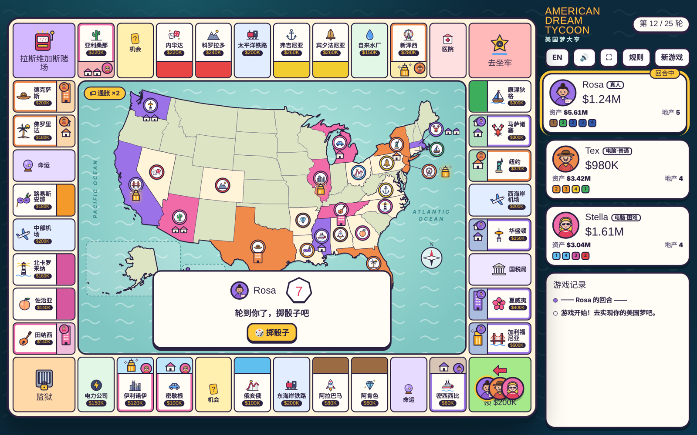
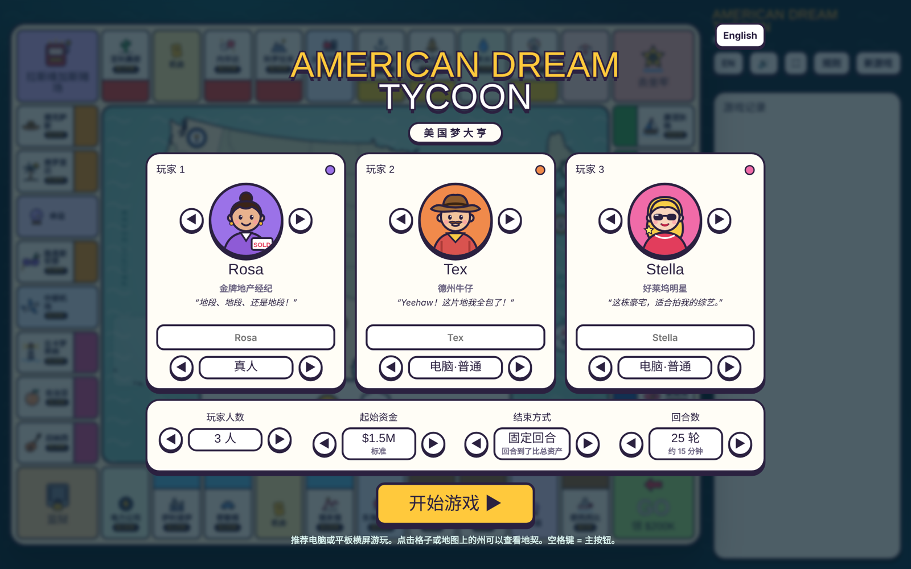

# 🎲 American Dream Tycoon
### 美国梦大亨

**Buy the states. Build the hotels. Collect the rent. Live the American Dream.**
**买下各州，盖起酒店，坐收租金，实现你的美国梦！**

`🇨🇳 中文` · `🇺🇸 English` · `👥 2–3 Players` · `🤖 AI Opponents` · `🌐 Play in Browser`

---

## 📖 Overview · 游戏简介

**American Dream Tycoon** is a cartoon board game about real estate across America. Roll the lucky 7-sided die, travel around a 40-tile board, buy US states, and turn empty lots into luxury hotels. Play with friends on one screen, or take on smart AI opponents. A live US map in the middle of the board shows who owns which state.

**美国梦大亨**是一款以美国房地产为主题的卡通桌游。掷出幸运七面骰，在 40 格棋盘上环游美国，买下各州，把空地一路升级成豪华酒店。可以和朋友同屏对战，也可以挑战电脑。棋盘中间的美国地图实时显示每个州的主人。

---

## ✨ Features · 游戏特色

| | Feature | 特色 |
|:---:|---|---|
| 🗺️ | **24 US states** in 8 color groups on a 40-tile board | 40 格棋盘，**24 个州**，8 个颜色组 |
| 🎲 | **One 7-sided die**: roll a 7 and you go again | **七面骰子**，掷出 7 再走一次 |
| 🏰 | **5 building levels**: from empty lot to Luxury Hotel | **5 级建筑**，从空地到豪华酒店 |
| 🤠 | **6 themed characters**, looks and lines only, so the game stays fair | **6 个主题角色**，只有外观和台词，保证公平 |
| 🤖 | **AI opponents** at Normal or Hard level | **电脑对手**，普通 / 困难两档 |
| 🔥 | **Comeback system**: anyone can turn the game around | **翻盘机制**，落后也有机会逆袭 |
| 🎰 | **Las Vegas Casino**: risk it all on one roll | **拉斯维加斯赌场**，一把定输赢 |
| 🌀 | **Live map events**: hurricanes, wildfires, housing booms | **地图实时事件**：飓风、山火、房市暴涨 |
| 🌐 | **Chinese / English** switch with one click | **中英文**一键切换 |

---

## 🎭 Characters · 角色

| Character | Who | 身份 | Catchphrase · 口头禅 |
|:---:|---|---|---|
| 🤠 **Tex** | Texas Cowboy | 德州牛仔 | "Yeehaw! I'll take the whole ranch!" |
| 💻 **Sam** | Silicon Valley Geek | 硅谷极客 | "The data says: buy." |
| 🎬 **Stella** | Hollywood Star | 好莱坞明星 | "This mansion is perfect for my show." |
| 💼 **Mr. Gold** | Wall Street Mogul | 华尔街大亨 | "Cash is king. I'll take it all." |
| 🏄 **Kai** | Hawaiian Surfer | 夏威夷冲浪手 | "Aloha! Ocean view, I'm in!" |
| 🏡 **Rosa** | Star Realtor | 金牌地产经纪 | "Location, location, location!" |

---

## ⚙️ Game Setup · 开局设置

| Option · 选项 | Choices · 可选 |
|---|---|
| 👥 Players · 玩家人数 | 2 or 3 · 2 人或 3 人 |
| 🎮 Each seat · 每个座位 | Human · AI Normal · AI Hard 真人 · 电脑普通 · 电脑困难 |
| 💰 Starting cash · 起始资金 | $800K Tight · $1.5M Standard · $3M Rich · $5M Big Spender 紧张 · 标准 · 富裕 · 土豪 |
| 🏁 Game ends · 结束方式 | Round limit · First bankruptcy · Last one standing 固定回合 · 第一人破产 · 玩到最后一人 |
| 🔁 Rounds · 回合数 | 15 · 25 · 40 · 60 (about 10–40 minutes · 约 10–40 分钟) |

---

## 🎮 How to Play · 玩法

1. 🎲 **Roll the die and move.** Pass GO to collect **$200K**.
   **掷骰子前进**，经过起点领工资 **$200K**。
2. 🏠 **Land on an unowned property.** Buy it, or pass.
   **停在无人的地**，可以买，也可以不买。
3. 💸 **Land on someone else's property.** Pay them rent.
   **停在别人的地**，要付租金。
4. 🔨 **Land on your own state.** Pay to upgrade it by 1 or 2 levels.
   **停在自己的州**，可以付费升 1 级或 2 级。
5. 🏆 **Win.** Have the highest net worth when the game ends.
   **获胜**：游戏结束时总资产最高的人赢。

> 💡 **Net worth** = cash + land price + money spent on buildings
> 💡 **总资产** = 现金 + 地价 + 建筑投入

---

## 📜 Rules · 规则

### 🏗️ Buildings · 建筑升级

| Level | Building | 建筑 |
|:---:|---|---|
| 0 | 🟫 Empty lot | 空地 |
| 1 | 🏠 1 House | 一栋房子 |
| 2 | 🏠🏠 2 Houses | 两栋房子 |
| 3 | 🏨 Hotel | 酒店 |
| 4 | 🏰 Luxury Hotel | 豪华酒店 |

- You can only upgrade when you **land on your own state**. Passing GO gives no free upgrade.
  只有**停到自己的州**才能升级，经过起点不送升级。
- Some cards, and a winning lucky 7 at the casino, give **free upgrades**.
  部分卡片，以及在赌场掷出幸运 7 赢钱，可以**免费升级**。
- 🌈 **Color set:** own all 3 states of one color and **every rent level doubles**.
  **集齐同色 3 个州，所有等级租金翻倍。**
- 🏷️ **Rent inflation:** every 5 rounds, **all rents rise 50%**.
  **租金通胀**：每 5 轮，**全场租金 +50%**。

### 🎲 The Lucky 7 · 幸运 7

- Roll a **7** and you **roll again**. 掷出 **7** 可以**再走一次**。
- Roll three 7s in a row and you go to **jail**. 连续三次 7 会被抓去**坐牢**。

### 🏛️ Special Tiles · 功能格

| Tile · 格子 | What happens · 效果 |
|---|---|
| 🏁 **GO · 起点** | Collect $200K each time you pass. 每次经过领 $200K。 |
| 🔒 **Jail · 监狱** | Pay $100K, use a jail card, or roll a 6 or 7 to get out. 付 $100K、用出狱卡，或掷出 6 或 7 出狱。 |
| 🎰 **Casino · 赌场** | Bet $100K, $300K or all-in on Small (1–3) or Big (5–7). A 4 means the house wins. 押小（1–3）或押大（5–7），掷出 4 庄家赢。 |
| 🏥 **Hospital · 医院** | Pay a $100K medical bill. 支付医疗费 $100K。 |
| 🏛️ **IRS · 国税局** | Pay 10% of your net worth. 缴纳总资产的 10%。 |
| 🚂✈️ **Rail & Airports · 铁路和机场** | Rent grows with how many you own: $50K → $400K. 拥有越多，租金越高：$50K → $400K。 |
| ⚡💧 **Utilities · 公共事业** | Rent = die roll × $20K, or × $50K if you own both. 租金 = 点数 × $20K，两家都有 × $50K。 |
| ❓ **Chance · 机会** | Personal luck: lottery wins, deed swaps, takeovers, free upgrades. 个人运气：中彩票、互换地契、恶意收购、免费升级。 |
| 🎴 **Fate · 命运** | Events for everyone: hurricanes, wildfires, booms, crashes. 全场事件：飓风、山火、房市暴涨或崩盘。 |

### 🔥 Comeback System · 翻盘机制

- 🎲 **Underdog wild cards:** a player far behind often draws extreme cards. Half are huge wins, half are disasters.
  **落后者极端卡**：大幅落后的玩家常抽到极端卡，一半大好，一半大坏。
- 🎡 **Comeback Wheel:** below 30% of the leader's net worth, you may spin the wheel, once every 3 turns. Prizes: take 30% of the leader's cash, +$800K, nothing, or lose half your cash.
  **逆天改命转盘**：资产低于第一名的 30% 时可以转，每 3 回合一次。结果可能是拿走第一名 30% 的现金、+$800K、什么都没有，或者失去一半现金。
- 🌳 **Tall trees catch the wind:** a runaway leader draws tougher Fate cards.
  **树大招风**：领先太多的玩家更容易抽到针对自己的命运卡。

### 💀 Bankruptcy · 破产

- When you can't pay, buildings are sold back at half price first, then land is mortgaged.
  现金不够时，先半价拆掉建筑，再抵押地产。
- If that is still not enough, you are **bankrupt** and all your property returns to the bank.
  如果还是不够就**破产**，地产全部归还银行。

---

## 🙏 Acknowledgements · 致谢

- 🗺️ US state outlines: [us-atlas](https://github.com/topojson/us-atlas), based on U.S. Census Bureau boundary data
  美国州界数据：us-atlas，源自美国人口普查局
- 🔤 Fonts: [Lilita One](https://fonts.google.com/specimen/Lilita+One) and [Fredoka](https://fonts.google.com/specimen/Fredoka) from Google Fonts
  字体：Google Fonts
- 🎲 Inspired by classic property-trading board games
  灵感来自经典地产桌游

---

## ⚠️ Disclaimer · 免责声明

American Dream Tycoon is an original fan-made game, created for fun and learning. It is not affiliated with, endorsed by, or connected to any board game brand or company. All money in the game is play money. The casino is part of the game only and has no link to real gambling. Characters are fictional.

美国梦大亨是一款原创游戏，仅供娱乐和学习。本游戏与任何桌游品牌或公司无关，也未获得其授权或背书。游戏中的金钱均为虚拟货币，赌场仅为游戏玩法，与真实赌博无关。所有角色均为虚构。

---

## 👋 About Me · 关于我

Hi, I'm **Ryan Yan**, a data analyst. I enjoy turning ideas into fun, interactive web projects.

你好，我是 **Ryan Yan**，一名数据分析师，喜欢把创意做成有趣的互动网页项目。

**🎲 Ready to build your empire? · 准备好建立你的地产帝国了吗？**

